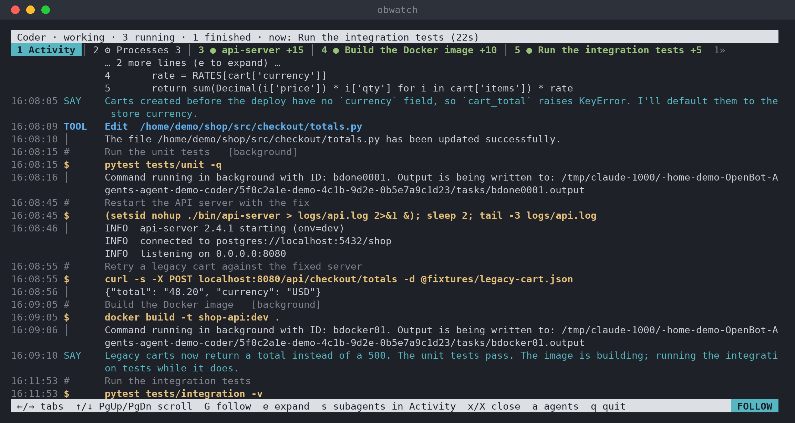
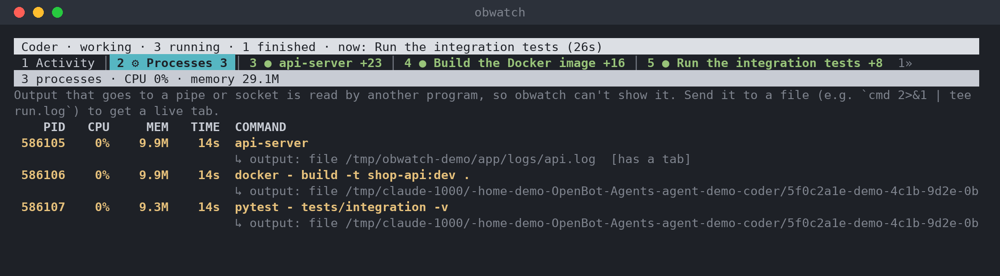
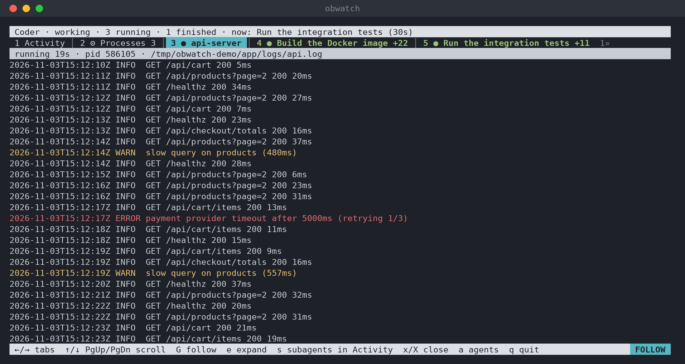
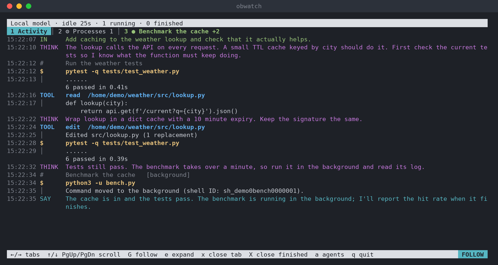
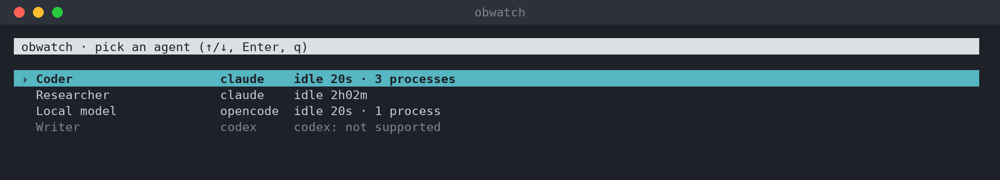

# obwatch

**See what your OpenBot agents are actually doing.** A terminal viewer for OpenBot agents that run on **Claude Code** or **opencode**, including opencode agents on a local model (LM Studio, Ollama and similar). It shows the agent's messages, its reasoning where the harness records it, every command with its stated purpose, the output, a live process tree, and tabs for everything the agent left running.

> **⚠️ This is a personal tool I made for my own testing.** It's experimental and built on OpenBot, Claude Code and opencode internals that can change at any time. Don't expect it to work properly on your setup. Feel free to try it, open an issue, or fork it.

## Why

When I use OpenBot agents for coding, the chat only shows me the agent's summary. I wanted to see what the agent is actually running: the commands and their output. I also wanted to attach to the logs of whatever it starts in its terminal, like a build, a server or a test run, while it's still going. obwatch is the quick tool I wrote for that.



## Features

- **Activity tab:** a live feed of the agent's session:
  - `IN`: messages the agent receives (from you, teammates, or task notifications)
  - `THINK`: the model's reasoning (opencode agents; see [Limitations](#limitations) for Claude)
  - `SAY`: what the agent writes
  - `#`: why it runs a command (the description it gives the command)
  - `$`: the command itself
  - `│` / `ERR`: the command's output, or its error
  - `TOOL`: file reads, edits, searches, and other tools
- **Processes tab:** every process the agent started, as a tree with CPU, memory and run time (with the total in cores, e.g. "CPU 2900% (≈29 cores)"), plus **where each one's output goes**: a file (with a tab), the terminal, a pipe or socket read by another program, or `/dev/null`. Programs launched through `systemd-run` are included too, although they run outside the agent's process tree.
- **A tab per subagent** (Claude Code and opencode): its own commands, output and messages, named after its description. Activity shows only the main agent unless you press `s`.
- **One tab per running process**, found automatically:
  - foreground commands while they run,
  - background jobs,
  - processes the agent detached with `nohup`/`setsid`, such as servers and long builds. These are followed through the log files they write to.
- **Running first, finished after.** `●` running, `✓` finished, `+N` new lines since you last looked. Error lines are red and warnings are yellow.
- **Agent list:** pick any agent and see whether it's working, idle, and how many processes it has running. Agents appear in the same order as in OpenBot's sidebar.
- **Read-only:** it never touches your agents and opens OpenBot's database read-only.
- **One file, no dependencies:** only Python's standard library.









## Requirements

- Linux, on the machine where OpenBot runs. obwatch reads `/proc`. It works fine over SSH.
- Python 3.8 or newer.
- Agents on the **Claude** or **opencode** provider. Agents on other providers appear in the list as "not supported".

## Install

```bash
mkdir -p ~/.local/bin
curl -fsSL https://raw.githubusercontent.com/Kirol54/OpenBotWatch/main/obwatch -o ~/.local/bin/obwatch
chmod +x ~/.local/bin/obwatch
```

If `~/.local/bin` isn't on your `PATH`, add it:

```bash
echo 'export PATH="$HOME/.local/bin:$PATH"' >> ~/.zshrc   # or ~/.bashrc
```

Update by running the same `curl` command again. Uninstall with `rm ~/.local/bin/obwatch`.

## Usage

```bash
obwatch                       # pick an agent from a list
obwatch coder                 # open the agent whose name contains "coder"
obwatch coder -f ~/app.log    # also pin any log file as a tab
obwatch coder --plain         # just print the activity feed, no tabs (good for piping or tmux panes)
obwatch --version
```

### Keys

| Key | Action |
|---|---|
| `←` `→` `Tab` `Shift-Tab` | previous / next tab |
| `1`–`9` | jump to a tab |
| `↑` `↓` `PgUp` `PgDn` `g` | scroll (pauses the live view) |
| `G` / `End` | follow live output again |
| `e` | show shortened outputs in full |
| `s` | show or hide subagent lines in Activity |
| `x` | close this tab (a running process keeps running) |
| `X` | close all finished tabs |
| `a` / `Esc` | back to the agent list |
| | The Processes tab starts at the top; scrolling pauses it and `G` makes it live again. |
| `q` | quit |

### Tabs

- The tab bar is ordered: **Activity**, **Processes** (`⚙`), pinned files (`≡`), **running** tabs (subagents are marked `↳`) (oldest first), then a yellow `┃` and the **finished** tabs (most recent first).
- Tab numbers follow this order, so a number can change when something finishes.
- When there are more tabs than fit, `«3` and `5»` show how many are hidden on each side.
- Tabs are named after the agent's description of the command (e.g. "Build the Docker image"), or after the program (e.g. `api-server`, `docker build`), or after the log file.
- Finished tabs stay for 15 minutes, up to 12 at a time. Finished foreground commands disappear after 10 seconds, because their output is already in Activity.
- A closed tab stays closed until a new process starts writing to the same file.

## How it works

OpenBot doesn't run the agent loop itself. It hands each agent to a **harness**: Claude Code for the Claude provider, opencode for the opencode provider. The harness sends prompts to the model, runs the tools (shell, file edits) and keeps the history. For a local LLM, LM Studio only serves the model; opencode is still the harness. obwatch reads what each harness leaves on disk:

| What | Claude Code | opencode |
|---|---|---|
| Agent names and workspaces | `~/.config/OpenBot/openbot.db`, opened read-only; order from `openbot-sidebar-layout-v1.json` | same |
| Activity feed | `~/.claude/projects/<workspace>/*.jsonl` (or `$CLAUDE_CONFIG_DIR/projects`), including subagents | `~/.local/share/opencode/opencode.db` (or `$XDG_DATA_HOME/opencode`), opened read-only: sessions whose directory is the agent's workspace, plus the ones OpenBot recorded for it, plus their subagents |
| Which processes belong to the agent | they inherit `CLAUDE_CODE_SESSION_ID` | they inherit `OPENCODE_SESSION_ID` |
| Subagents | `<session>/subagents/agent-*.jsonl` with a `.meta.json` (description, type, finished) | child sessions in `opencode.db` (`parent_id`); title, agent, busy/idle times |
| Command output files | `/tmp/claude-<uid>/<workspace>/<session>/tasks/*.output` | `~/.local/share/opencode/shell/<project>/sh_*.out` |

Both session variables survive `setsid`/`nohup`, so detached servers and builds are found too. Children of those processes count as well, even when a tool started them with a cleaned environment. An opencode command that drops the environment itself (`env -i …`) is matched by start time against the agent's `sh_*.out` files. obwatch looks them up in `/proc` and follows the files they write to: their stdout/stderr, plus open files ending in `.log`, `.out`, `.output` or `.txt`. Programs started with `systemd-run` lose the variable; obwatch finds them by their systemd unit name (`--unit=`), or by the output pipe they share with `systemd-run --pipe`.

MCP servers that the harness starts are filtered out, so only the agent's own commands show up.

## Limitations

- **No reasoning for Claude agents.** OpenBot starts Claude Code without `--thinking-display summarized`, so the reasoning in the session files is empty. The `#` line, the reason the agent gives for each command, usually covers it. If OpenBot ever enables summaries, they appear automatically as `THINK` lines. opencode stores the model's reasoning as plain text, so opencode agents show it.
- **Output sent to a pipe or socket can't be shown live.** If a tool runs a program and reads its output itself (e.g. a test runner, or `systemd-run --pipe`), only that tool sees it. The Processes tab shows where it goes. To get a live tab, have the command write to a file, e.g. `... 2>&1 | tee run.log`.
- **Python output to a file arrives in chunks.** Python buffers stdout when it isn't a terminal, so a log can stay empty for a while. Run it with `python -u` or `PYTHONUNBUFFERED=1`; the Processes tab points this out.
- **Linux only**, because it relies on `/proc`.
- A program that writes to its own log file (not stdout) only becomes a tab if the file ends in `.log`, `.out`, `.output` or `.txt`. Pin anything else with `-f`.
- Processes inside Docker containers aren't visible. The `docker build` / `docker run` command's own output is.
- The file formats come from OpenBot, Claude Code and opencode internals and may change between versions. Tested with OpenBot 0.54.0, Claude Code 2.1.312–2.1.316 and opencode 2.2.5.

## Privacy

Session files can contain anything the agent has seen, including secrets that appear in command output. obwatch only shows them in your terminal and sends nothing anywhere. Take care when you share screenshots of it.

## Development

Tests use only the standard library:

```bash
python3 -m unittest discover -s tests
```

GitHub Actions runs them on Python 3.8 to 3.13 (`.github/workflows/test.yml`).

`dev/demo.py` creates a fake OpenBot setup: a Claude Code agent and an opencode agent with sessions and running processes, an idle agent, and one on an unsupported provider. Use it to try obwatch or work on it without real agents:

```bash
python3 dev/demo.py start
HOME=/tmp/obwatch-demo/home ./obwatch coder
python3 dev/demo.py stop
```

`dev/screenshot.py` regenerates the images in `docs/` from the demo. It needs `pyte`, `Pillow` and the DejaVu Sans Mono font (`pip install pyte pillow`; set `FONT_DIR` if the font isn't in `/usr/share/fonts/truetype/dejavu`):

```bash
python3 dev/demo.py start
HOME=/tmp/obwatch-demo/home python3 dev/screenshot.py docs/
python3 dev/demo.py stop
```

## License

MIT, see [LICENSE](LICENSE).
