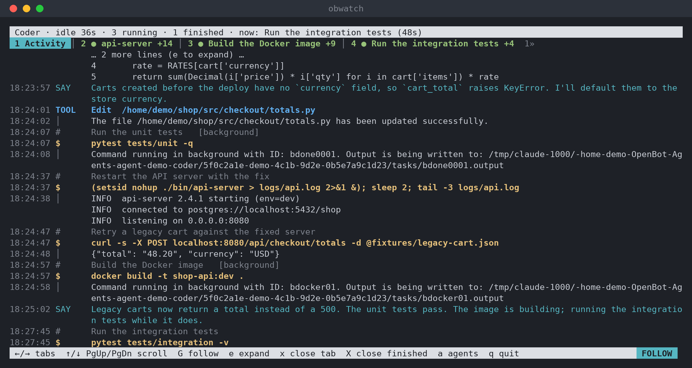
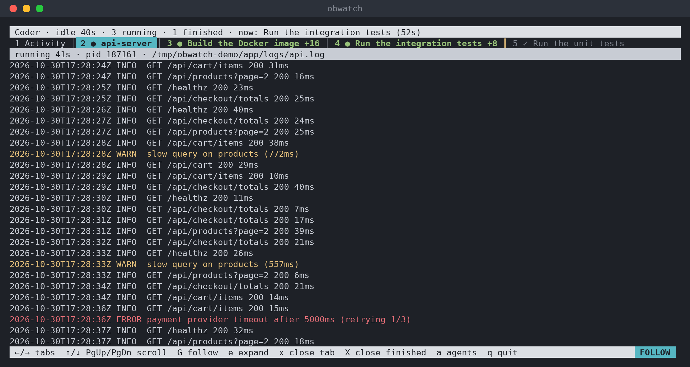
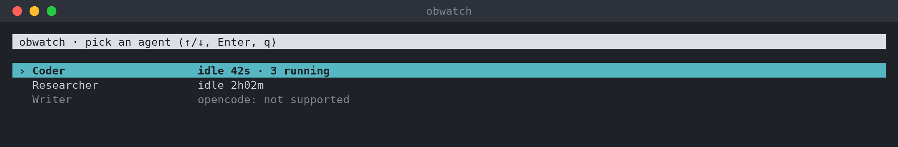

# obwatch

**See what your OpenBot agents are actually doing.** A terminal viewer for OpenBot agents that run on Claude Code. It shows the agent's messages, every command with its stated purpose, the output, and live tabs for everything the agent left running.

> **⚠️ This is a personal tool I made for my own testing.** It's experimental and built on OpenBot and Claude Code internals that can change at any time. Don't expect it to work properly on your setup. Feel free to try it, open an issue, or fork it.

## Why

When I use OpenBot agents for coding, the chat only shows me the agent's summary. I wanted to see what Claude Code is actually running: the commands and their output. I also wanted to attach to the logs of whatever it starts in its terminal, like a build, a server or a test run, while it's still going. obwatch is the quick tool I wrote for that.



## Features

- **Activity tab:** a live feed of the agent's session:
  - `IN`: messages the agent receives (from you, teammates, or task notifications)
  - `SAY`: what the agent writes
  - `#`: why it runs a command (the description it gives the command)
  - `$`: the command itself
  - `│` / `ERR`: the command's output, or its error
  - `TOOL`: file reads, edits, searches, and other tools
- **One tab per running process**, found automatically:
  - foreground commands while they run,
  - background jobs,
  - processes the agent detached with `nohup`/`setsid`, such as servers and long builds. These are followed through the log files they write to.
- **Running first, finished after.** `●` running, `✓` finished, `+N` new lines since you last looked. Error lines are red and warnings are yellow.
- **Agent list:** pick any agent and see whether it's working, idle, and how many processes it has running.
- **Read-only:** it never touches your agents and opens OpenBot's database read-only.
- **One file, no dependencies:** only Python's standard library.





## Requirements

- Linux, on the machine where OpenBot runs. obwatch reads `/proc`. It works fine over SSH.
- Python 3.8 or newer.
- Agents that use the **Claude** provider. Agents on other providers (such as opencode) appear in the list, but there's nothing to watch for them yet.

## Install

```bash
mkdir -p ~/.local/bin
curl -fsSL https://raw.githubusercontent.com/Kirol54/OpenBotWatch/main/obwatch -o ~/.local/bin/obwatch
chmod +x ~/.local/bin/obwatch
```

If `~/.local/bin` isn't on your `PATH`, add it:

```bash
echo 'export PATH="$HOME/.local/bin:$PATH"' >> ~/.zshrc   # or ~/.bashrc
```

Update by running the same `curl` command again. Uninstall with `rm ~/.local/bin/obwatch`.

## Usage

```bash
obwatch                       # pick an agent from a list
obwatch coder                 # open the agent whose name contains "coder"
obwatch coder -f ~/app.log    # also pin any log file as a tab
obwatch coder --plain         # just print the activity feed, no tabs (good for piping or tmux panes)
obwatch --version
```

### Keys

| Key | Action |
|---|---|
| `←` `→` `Tab` `Shift-Tab` | previous / next tab |
| `1`–`9` | jump to a tab |
| `↑` `↓` `PgUp` `PgDn` `g` | scroll (pauses the live view) |
| `G` / `End` | follow live output again |
| `e` | show shortened outputs in full |
| `x` | close this tab (a running process keeps running) |
| `X` | close all finished tabs |
| `a` / `Esc` | back to the agent list |
| `q` | quit |

### Tabs

- The tab bar is ordered: **Activity**, pinned files (`≡`), **running** tabs (oldest first), then a yellow `┃` and the **finished** tabs (most recent first).
- Tab numbers follow this order, so a number can change when something finishes.
- When there are more tabs than fit, `«3` and `5»` show how many are hidden on each side.
- Tabs are named after the agent's description of the command (e.g. "Build the Docker image"), or after the program (e.g. `api-server`, `docker build`), or after the log file.
- Finished tabs stay for 15 minutes, up to 12 at a time. Finished foreground commands disappear after 10 seconds, because their output is already in Activity.
- A closed tab stays closed until a new process starts writing to the same file.

## How it works

| What | Where it comes from |
|---|---|
| Agent names and workspaces | `~/.config/OpenBot/openbot.db`, opened read-only |
| Activity feed | Claude Code session files: `~/.claude/projects/<workspace>/*.jsonl` (or `$CLAUDE_CONFIG_DIR/projects`), including subagents |
| Process tabs | Every process an agent's command starts inherits `CLAUDE_CODE_SESSION_ID`, even when detached with `setsid`/`nohup`. obwatch finds these processes in `/proc` and follows the files they write to: their stdout/stderr, plus open files ending in `.log`, `.out`, `.output` or `.txt` |
| Background and foreground commands | Claude Code writes their output to `/tmp/claude-<uid>/<workspace>/<session>/tasks/*.output` |

MCP servers that Claude Code starts are filtered out, so only the agent's own commands show up.

## Limitations

- **No reasoning text.** OpenBot starts Claude Code without `--thinking-display summarized`, so the reasoning in the session files is empty. The `#` line, the reason the agent gives for each command, usually covers it. If OpenBot ever enables summaries, they appear automatically as `THINK` lines.
- **Linux only**, because it relies on `/proc`.
- A program that writes to its own log file (not stdout) only becomes a tab if the file ends in `.log`, `.out`, `.output` or `.txt`. Pin anything else with `-f`.
- Processes inside Docker containers aren't visible. The `docker build` / `docker run` command's own output is.
- The file formats come from OpenBot and Claude Code internals and may change between versions. Tested with OpenBot 0.54.0 and Claude Code 2.1.312.

## Privacy

Session files can contain anything the agent has seen, including secrets that appear in command output. obwatch only shows them in your terminal and sends nothing anywhere. Take care when you share screenshots of it.

## Development

`dev/demo.py` creates a fake OpenBot setup: three demo agents, a session, and a few running processes. Use it to try obwatch or work on it without real agents:

```bash
python3 dev/demo.py start
HOME=/tmp/obwatch-demo/home ./obwatch coder
python3 dev/demo.py stop
```

`dev/screenshot.py` regenerates the images in `docs/` from the demo. It needs `pyte`, `Pillow` and the DejaVu Sans Mono font (`pip install pyte pillow`; set `FONT_DIR` if the font isn't in `/usr/share/fonts/truetype/dejavu`):

```bash
python3 dev/demo.py start
HOME=/tmp/obwatch-demo/home python3 dev/screenshot.py docs/
python3 dev/demo.py stop
```

## License

MIT, see [LICENSE](LICENSE).
