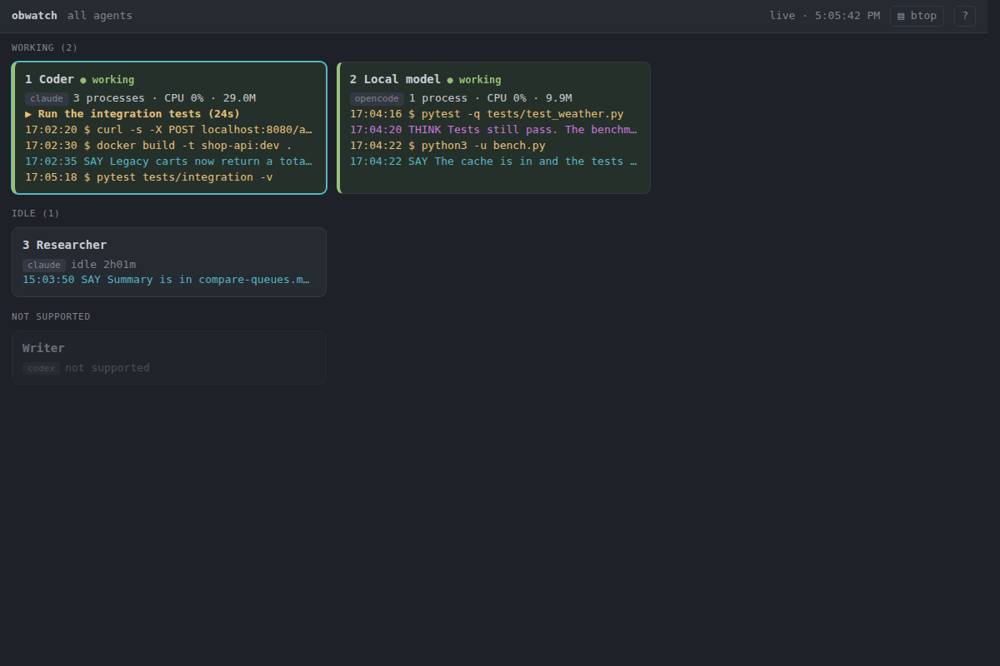
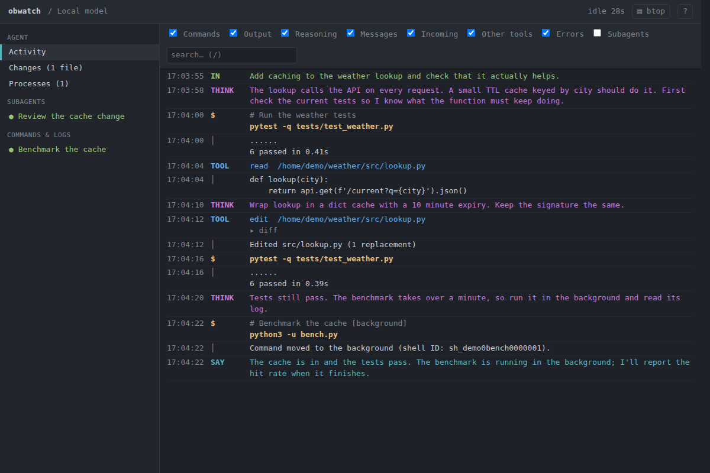
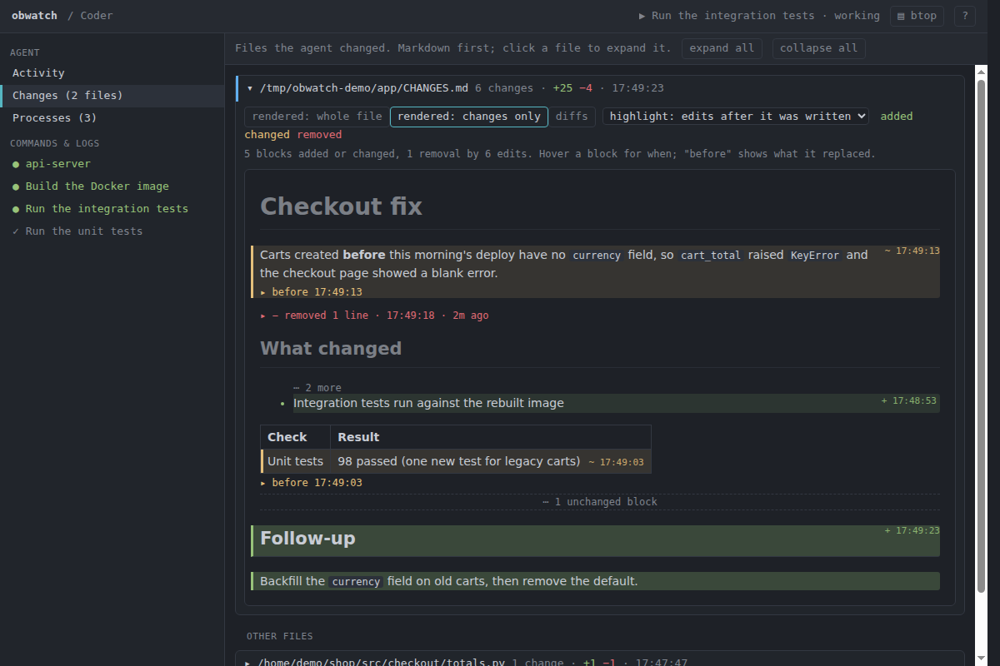

# obwatch

**See what your OpenBot agents are actually doing.** obwatch shows the commands an agent runs, their output, its messages and reasoning, the processes it started, and the files it changed. It works in the terminal or as a web page, for agents on **Claude Code** or **opencode** (including opencode on a local model).

> **⚠️ This is a personal tool I made for my own testing.** It's experimental and built on OpenBot, Claude Code and opencode internals that can change at any time. Don't expect it to work properly on your setup. Feel free to try it, open an issue, or fork it.



## Why

When I use OpenBot agents for coding, the chat only shows me the agent's summary. I wanted to see what the agent is actually running, and the output, without filling the chat with it. I also wanted to follow the logs of whatever it starts, like a build, a server or a test run, while it's still going, and to review what it changed. obwatch is the tool I wrote for that.

## Features

- **Activity:** a live feed of each command with its stated purpose and its output, plus messages, reasoning and other tool calls.
- **Live logs:** a tab for every command, background job and detached process (servers, builds) the agent started.
- **Processes:** the agent's process tree with CPU, memory, and where each one's output goes.
- **Subagents:** each gets its own tab.
- **Changes:** every file the agent changed, as side-by-side diffs. Markdown is rendered with the changes marked and timed, and git files show everything not committed yet.
- **Web page:** every agent at once, working ones on top. Filters, search, keyboard shortcuts, and btop at the bottom of the page.
- **Safe to run:** read-only. Your agents and OpenBot's database are never changed. The web page is local or LAN-only and behind a token.
- **One file:** only Python's standard library, installed with one `curl`.

## Requirements

- Linux, on the machine where OpenBot runs (obwatch reads `/proc`). It works fine over SSH.
- Python 3.8 or newer.
- Agents on the **Claude** or **opencode** provider. Agents on other providers show as "not supported".
- Only for the web page's btop pane: `btop`, and internet access once to download xterm.js.

## Install

```bash
mkdir -p ~/.local/bin
curl -fsSL https://raw.githubusercontent.com/Kirol54/OpenBotWatch/main/obwatch -o ~/.local/bin/obwatch
chmod +x ~/.local/bin/obwatch
```

If `~/.local/bin` isn't on your `PATH`, add it:

```bash
echo 'export PATH="$HOME/.local/bin:$PATH"' >> ~/.zshrc   # or ~/.bashrc
```

Update by running the same `curl` command again. Uninstall with `rm ~/.local/bin/obwatch`.

## Usage

In the terminal:

```bash
obwatch                       # pick an agent from a list
obwatch coder                 # open the agent whose name contains "coder"
obwatch coder -f ~/app.log    # also pin any log file as a tab
obwatch coder --plain         # just print the activity feed (good for piping or tmux panes)
obwatch --version
```

As a web page:

```bash
obwatch --web                 # this machine only; prints a link with a secret token
obwatch --web --lan           # your local network only, e.g. http://192.0.2.50:8765/?token=…
obwatch --web --port 9000     # another port (default 8765)
```

Open the printed link. With plain `--web`, forward the port from your computer first: `ssh -L 8765:localhost:8765 you@your-server`. On the page, `?` lists the keyboard shortcuts.

## The terminal view


### Activity

A live feed of the agent's session:

| Line | What |
|---|---|
| `IN` | messages the agent receives (from you, teammates, or task notifications) |
| `THINK` | the model's reasoning (opencode agents; see [Limitations](#limitations) for Claude) |
| `SAY` | what the agent writes |
| `#` | why it runs a command (the description it gives the command) |
| `$` | the command itself |
| `│` / `ERR` | the command's output, or its error |
| `TOOL` | file reads, edits, searches, and other tools |

Subagent lines are hidden here (each subagent has its own tab); `s` shows them.

### Tabs

- **Processes** (`⚙`): every process the agent started, as a tree with CPU, memory and run time (with the total in cores, e.g. "CPU 2900% (≈29 cores)"). It also shows **where each one's output goes**: a file (with a tab), the terminal, a pipe or socket read by another program, or `/dev/null`. Programs launched through `systemd-run` are included, although they run outside the agent's process tree.
- **A tab per subagent** (`↳`, Claude Code and opencode): its own commands, output and messages, named after its description.
- **A tab per running process**, found automatically: foreground commands while they run, background jobs, and processes the agent detached with `nohup`/`setsid`, such as servers and long builds. These are followed through the log files they write to.
- Order: Activity, Processes, pinned files (`≡`), **running** tabs (oldest first), a yellow `┃`, then **finished** tabs (most recent first). Tab numbers follow this order, so a number can change when something finishes. `«3` and `5»` show how many tabs are hidden on each side.
- `●` running, `✓` finished, `+N` new lines since you last looked. Error lines are red and warnings yellow.
- Tabs are named after the agent's description of the command (e.g. "Build the Docker image"), the program (e.g. `api-server`), or the log file.
- Finished tabs stay for 15 minutes, up to 12 at a time. Finished foreground commands disappear after 10 seconds, because their output is already in Activity. A closed tab stays closed until a new process writes to the same file.
- The **agent list** shows whether each agent is working or idle, its provider, and how many processes it has, in the same order as OpenBot's sidebar.


### Keys

| Key | Action |
|---|---|
| `←` `→` `Tab` `Shift-Tab` | previous / next tab |
| `1`–`9` | jump to a tab |
| `↑` `↓` `PgUp` `PgDn` `g` | scroll (pauses the live view) |
| `G` / `End` | follow live output again |
| `e` | show shortened outputs in full |
| `s` | show or hide subagent lines in Activity |
| `x` | close this tab (a running process keeps running) |
| `X` | close all finished tabs |
| `a` / `Esc` | back to the agent list |
| `q` | quit |

## The web page



- **Overview:** every agent at once. Working agents come first, highlighted, with what each is running now, its last few actions, processes and CPU.
- **Agent page:** Activity with expandable outputs and reasoning, filters (commands, output, reasoning, messages, tools, errors, subagents), search and auto-follow, plus tabs for subagents, live command logs and processes.
- **Keyboard:** press `?` on the page for every shortcut.

### Changes



- Every file the agent changed, grouped by file: Markdown first, then other files, then files that no longer exist (marked "deleted").
- **Diffs** are side by side, with line numbers. Edits from earlier days show their date.
- **Markdown is rendered with the changes marked:** green for added, yellow for changed, each with the time of the edit. "before" on a changed block shows what it replaced, word by word, and red markers show removed text.
- **Views** (`m` switches): the whole file, **changes only** (just the changed parts under their headings, with `⋯` for hidden parts), or diffs.
- **Which changes to mark** (`H` switches):
  - In a git repository, by default, everything not committed yet. This includes changes made by shell commands or scripts, marked "by a command" because their exact time isn't recorded.
  - Outside git, by default, the edits made after the file was written.
  - Or: everything the agent wrote, the last hour, the last 10 minutes, or only the latest edit.
- The page stays still while you read. When files change while you're scrolled down, a notice says so; click it or press `r`.

### btop pane

Press `t` (or click "▤ btop") on any page to open btop at the bottom, in full color, running on the server. btop runs only while the pane is open.

- **Size:** S/M/L/XL, drag its top edge, or `+`/`-`. Change the font with `Alt`+`+`/`-` until all your CPU cores fit.
- **Keys:** click it (or press `T`) to type into btop; `Ctrl`+`]` gives the keys back to the page. btop's own keys work too, including the ones that kill processes.
- **How:** the pane uses [xterm.js](https://xtermjs.org/), the terminal VS Code uses. To keep obwatch a single file, the first time you open the pane obwatch downloads xterm.js 6.0.0 from the npm registry. It checks the download against hashes built into obwatch and keeps it in `~/.cache/obwatch`. Your browser loads it from obwatch, not from the internet.

### Access and security

- **Sign-in:** open the printed link once. It signs that browser in with a cookie (HttpOnly, SameSite=Strict), so other pages, new tabs and reloads work until obwatch restarts. Each start makes a new token, so after a restart open the new link.
- **Every request needs the token.** Requests addressed to any other host are refused, and btop only accepts connections from the page itself, so other websites in your browser can't read anything or open btop.
- **`--web`** listens on 127.0.0.1 only. Reach it with `ssh -L`.
- **`--lan`** listens only on the address of the interface your server reaches the internet through (its default route), not on VPN or Docker interfaces. It only answers devices inside that network, and refuses to start if the network isn't private.
- **Plain HTTP:** anyone who can watch traffic on your network could see the token. Use `--lan` on a network you trust. Don't share the link: transcripts can contain secrets, and anyone with it can use btop.
- **Connection log:** the terminal running `--web` logs every connection attempt: new clients, page loads, btop opened and closed, and refused requests with the reason. Live updates are summarized once a minute.
- **If the page keeps loading forever**, a firewall on the server is probably dropping the port, and nothing shows up in the connection log. With ufw: `sudo ufw allow from 192.0.2.0/24 to 192.0.2.50 port 8765 proto tcp` (use the network and address obwatch prints).

## How it works

OpenBot doesn't run the agent loop itself. It hands each agent to a **harness**: Claude Code for the Claude provider, opencode for the opencode provider. The harness sends prompts to the model, runs the tools (shell, file edits) and keeps the history. For a local LLM, LM Studio only serves the model; opencode is still the harness. obwatch reads what each harness leaves on disk:

| What | Claude Code | opencode |
|---|---|---|
| Agent names and workspaces | `~/.config/OpenBot/openbot.db`, opened read-only; order from `openbot-sidebar-layout-v1.json` | same |
| Activity feed | `~/.claude/projects/<workspace>/*.jsonl` (or `$CLAUDE_CONFIG_DIR/projects`), plus `~/.config/OpenBot/provider-accounts/*/projects/<workspace>` for each Claude account added to OpenBot | `~/.local/share/opencode/opencode.db` (or `$XDG_DATA_HOME/opencode`), opened read-only: sessions in the agent's workspace, plus the ones OpenBot recorded for it |
| Which processes belong to the agent | they inherit `CLAUDE_CODE_SESSION_ID` | they inherit `OPENCODE_SESSION_ID` |
| Subagents | `<session>/subagents/agent-*.jsonl` with a `.meta.json` (description, type, finished) | child sessions in `opencode.db` (`parent_id`) |
| Command output files | `/tmp/claude-<uid>/<workspace>/<session>/tasks/*.output` | `~/.local/share/opencode/shell/<project>/sh_*.out` |
| Changes | Edit and Write tool calls in the feed, plus `git show HEAD:<file>` for files in a git repository | same |

Both session variables survive `setsid`/`nohup`, so detached servers and builds are found too. Children of those processes count as well, even when a tool started them with a cleaned environment. An opencode command that drops the environment itself (`env -i …`) is matched by start time against the agent's `sh_*.out` files. obwatch looks the processes up in `/proc` and follows the files they write to: their stdout/stderr, plus open files ending in `.log`, `.out`, `.output` or `.txt`. Programs started with `systemd-run` lose the variable; obwatch finds them by their systemd unit name (`--unit=`), or by the output pipe they share with `systemd-run --pipe`. MCP servers that the harness starts are filtered out.

## Limitations

- **No reasoning for Claude agents.** OpenBot starts Claude Code without `--thinking-display summarized`, so the reasoning in the session files is empty. The `#` line, the reason the agent gives for each command, usually covers it. If OpenBot ever enables summaries, they appear automatically as `THINK` lines. opencode agents show their reasoning.
- **Output sent to a pipe or socket can't be shown live.** If a tool runs a program and reads its output itself (e.g. a test runner, or `systemd-run --pipe`), only that tool sees it. The Processes tab shows where it goes. To get a live tab, have the command write to a file, e.g. `... 2>&1 | tee run.log`.
- **Python output to a file arrives in chunks**, because Python buffers stdout when it isn't a terminal. Run it with `python -u` or `PYTHONUNBUFFERED=1`; the Processes tab points this out.
- A program that writes to its own log file (not stdout) only becomes a tab if the file ends in `.log`, `.out`, `.output` or `.txt`. Pin anything else with `-f`.
- Processes inside Docker containers aren't visible. The `docker build` / `docker run` command's own output is.
- Changes lists the files the agent changed with its edit tools. A file it only ever changed with shell commands (`sed`, a script) isn't listed; for listed files in git, such changes are still marked.
- **Linux only**, because it relies on `/proc`.
- The file formats come from OpenBot, Claude Code and opencode internals and may change between versions. Tested with OpenBot 0.54.0, Claude Code 2.1.312–2.1.316 and opencode 2.2.5.

## Privacy

Session files can contain anything the agent has seen, including secrets that appear in command output. obwatch only shows them in your terminal or on the web page and sends nothing anywhere. Its only outgoing connection is the one-time xterm.js download when you first open the btop pane, which sends nothing about you or your agents. Take care when you share screenshots of it.

## Development

Tests use only the standard library:

```bash
python3 -m unittest discover -s tests
```

GitHub Actions runs them on Python 3.8 to 3.13 (`.github/workflows/test.yml`).

`dev/demo.py` creates a fake OpenBot setup: a Claude Code agent and an opencode agent with sessions and running processes, an idle agent, and one on an unsupported provider. Use it to try obwatch or work on it without real agents:

```bash
python3 dev/demo.py start
HOME=/tmp/obwatch-demo/home ./obwatch coder
python3 dev/demo.py stop
```

`dev/screenshot.py` regenerates the terminal images in `docs/` from the demo. It needs `pyte`, `Pillow` and the DejaVu Sans Mono font (`pip install pyte pillow`; set `FONT_DIR` if the font isn't in `/usr/share/fonts/truetype/dejavu`):

```bash
python3 dev/demo.py start
HOME=/tmp/obwatch-demo/home python3 dev/screenshot.py docs/
python3 dev/demo.py stop
```

## Contributing

Read [AGENTS.md](AGENTS.md) first. This repo is public, and nothing from anyone's machine, network or agent conversations may be committed. The tests include a privacy check, and `dev/pre-commit` runs it before every commit.

## License

MIT, see [LICENSE](LICENSE).
